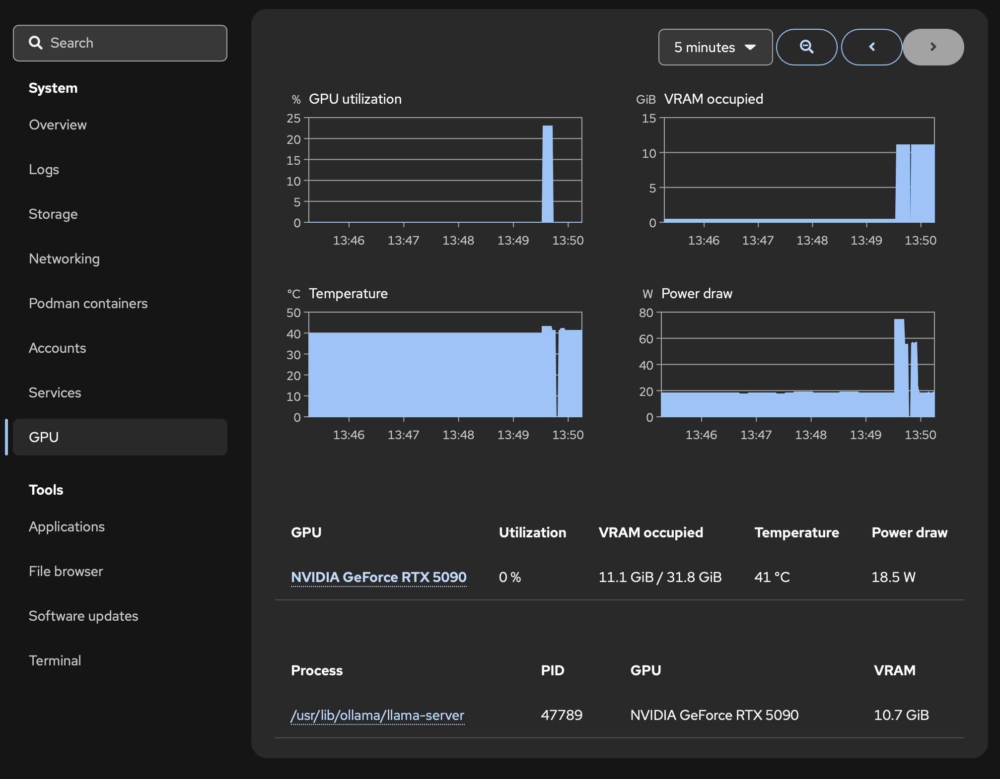

# README for Humans
_Written by a human._

This is a [Cockpit](https://cockpit-project.org) module that adds a page to the dashboard to display live plots of (NVIDIA) GPU-related statistics and lists the processes currently utilizing the GPU. Stylistically, it is designed to look exactly like any of the builtin modules which ship with Cockpit, which is why we [plucked](src/vendor/cockpit) certain (non-standard) JS+CSS components from Cockpit. The other design decision is to reuse [PCP](https://pcp.io)'s built-in logging, instead of polling and then logging `nvidia-smi` independently. This also means if you have `pcp` and the `pmlogger` service is enabled, that is sufficient (but see the limitations below).

# Installation
My recommendation is to install manually. A prerequisite is having `pcp` and enabling the `pmlogger` service. Begin by building with `npm` as usual. To deploy, install [pmdanvidia](https://man.archlinux.org/man/extra/pcp/pmdanvidia.1.en) which comes with PCP but is not installed by default; each distro has its own location for it. We also use a small logger [plugin](pcp/core) that asks PCP to record GPU temperatures which otherwise is not logged by default; in fact, temperature is the only metric for which we need this plugin. This must be placed in `pmlogconf`. These last two steps for arch specifically appear here: [scripts/install-pcp.sh](scripts/install-pcp.sh). To install the cockpit module, simply move `dist` to `/usr/local/share/cockpit/cockpit-nvidia`. This is also done here: [scripts/install-plugin.sh](scripts/install-plugin.sh).

For home-manager on non-NixOS distros, I personally use a module available in the root [flake](flake.nix) which exposes `programs.cockpit-nvidia.enable`. But this only automates the `npm build` and the cockpit module steps (in fact, we use the user version of Cockpit's plugin locations). To do the first step listed above, on arch, for example, you still need `nix run github:i-am-karan-singh/cockpit-nvidia#setup-pcp` once.

# Limitations
Only supports NVIDIA. We also did not test with multiple GPUs.

The reported total VRAM usage includes a portion reserved by the driver, which does not match `nvidia-smi`.

Finally, PCP's live plotting utilities, which we reuse, need a list of metrics, the root of the log archives and a time range as arguments. They only work when all metrics of interest are present in _all_ of the log archives, including the ones outside the time range. Changing this behavior seems to need upstream patches. This means once you enable this module, we will have a mixture of logs, some with GPU info and others without, which poses a problem. My recommendation (🤡) is to simply delete all the old metrics (for example, in `/var/log/pcp/pmloggger/HOST_NAME`).

FWIW earlier commits (successfully) circumvented the above problem by mirroring all logs collected in the last 7 days, filtering these for the presence of GPU info, and reflinking -- symlinking runs into problems -- them somewhere in `/var/log` with a python script that was executed upon page load and then (with caching) every 15 minutes. This is somewhat (although not unacceptably) slow. A nicer alternative would be to create a modified version of the `pmlogger` service that logs GPU stats in a new location. In any case, I am happy with my current _solution_.
